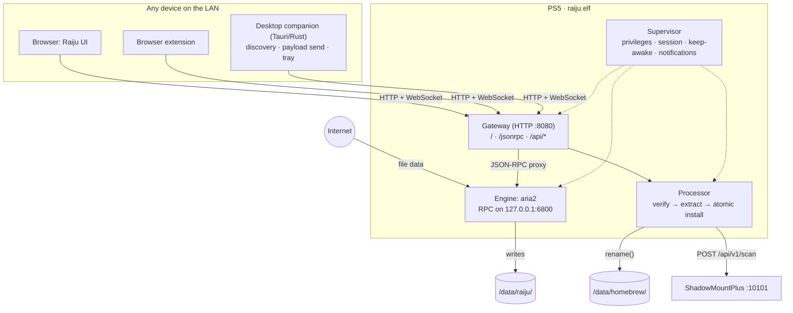

# Raiju — Architecture

## Overview



Data path for a download: **Internet → PS5 NIC → aria2 → NVMe → (extract) → rename into place**. Clients only send commands and receive progress; no file data passes through them.

## Components

### 1. Payload: `raiju.elf` (C/C++, ps5-payload-sdk)

Single ELF, sent through the existing ELF loader (port 9021).

**Supervisor**
- Runs with the privileges the loader grants, and owns no kernel state it did not create (ADR 0006). Measured on firmware 13600007 (#2): the loader starts a payload with `euid 0` and no jail (`jaildir 0`), and `mkdir /data/raiju` succeeds before any escalation runs — so escalation is a last resort, not a ritual. No borrowing another process's jail, no blanket capability grant; if an operation is proven to need more privilege, the narrowest step that works is recorded with its measurement and reverted on every exit path.
- Creates `/data/raiju/{downloads,staging,trash,session,www}` on first run.
- Starts the engine and gateway, and shows a PS5 notification: `Raiju ready — http://<ip>:8080 · code 4821`.
- Single-instance guard: if Raiju is already running, the new copy exits and re-shows the notification. An `flock` on `/data/raiju/session/raiju.lock` answers that, and the second launch is refused with `EWOULDBLOCK` (#2).
- Ends through `payload_exit()`. Returning from `main` hands the hijacked process back to its C++ teardown, which dies with an uncaught `system_error` a few milliseconds later (#2).

**Engine: aria2**
- Preferred: `motrixapp/aria2` (Motrix's fork: 64 connections per server, SQLite session persistence). Fallback: upstream aria2 1.37+.
- Build: static, `--without-gnutls --with-openssl --with-libz --without-libxml2 --without-sqlite3` for M0; add c-ares, then libxml2/sqlite later.
- Integration mode (decide in M0, record as ADR):
  - **A. Embedded `libaria2`** (`--enable-libaria2`) running in a thread inside `raiju.elf`, with `enable-rpc=true` set in its options. One process, one ELF.
  - **B. Standalone `aria2c`** started by the supervisor. Simpler build, but needs process spawning to work from a payload.
- aria2 runs a single event loop on FreeBSD `kqueue`. TLS on a Zen 2 core with AES-NI handles well over 1 Gbps, so one thread is not the bottleneck.

**Processor (post-download pipeline)**

Runs in its own worker thread. When aria2 reports a download complete (`onDownloadComplete`), the payload passes the processor a "download complete" event with the file (or folder) path and the size the server announced; the processor picks up that job. Each job is a small state machine, persisted to `/data/raiju/session/jobs.json`. On startup it resumes from the last completed stage.

```mermaid
stateDiagram-v2
    direction LR
    [*] --> Downloading
    Downloading --> Verifying
    Verifying --> Classifying
    Classifying --> Installing: image
    Classifying --> Extracting: archive
    Classifying --> Installing: other
    Classifying --> AwaitingTitleId: no title ID
    Extracting --> Installing
    Extracting --> AwaitingTitleId: no title ID
    AwaitingTitleId --> Installing: user enters ID
    Installing --> Conflict: name taken
    Conflict --> Installing: rename / replace
    Conflict --> Cancelled: cancel
    Extracting --> Cancelled: cancel
    Installing --> Rescan
    Rescan --> Notifying
    Notifying --> Ready
    Ready --> [*]
    Downloading --> Failed
    Verifying --> Failed
    Classifying --> Failed
    Extracting --> Failed
    Installing --> Failed
    Rescan --> Failed
    Notifying --> Failed
    Failed --> Downloading: retry
    note right of Failed: keeps files; retry returns to the failed stage (Downloading after a download or verify failure), or discard
```



The code lives in `payload/processor`: `job.h` (the job model), `job_store.h` (jobs.json), `pipeline.h` (one stage at a time), `processor.h` (the queue and its events) and `space.h`.

- **Stage semantics.** A job's `stage` is the next stage to run, and it only advances once that stage's work is done, so after a crash the stage that was running simply runs again. Every stage is safe to rerun: extraction wipes `staging/<job-id>/` first, and the install step recognises a move that already happened (see step 4).
- **jobs.json.** `{"version":1,"jobs":[…]}` with one flat object per job: stage, failed stage and error, download path and original name, expected and uncompressed sizes, install root, keep-archive flag, conflict policy, kind, payload type and path, title ID and its source, committed install path, conflict choice, and extraction progress. It is rewritten after every stage: written to `jobs.json.tmp`, fsynced, renamed over `jobs.json`, then the directory is fsynced, so a crash leaves the old or the new file, never a mix. On load the file is untrusted: it is capped at 4 MiB and 512 jobs, parsed by a strict JSON reader (nesting capped, escapes validated, no NUL in strings), job IDs must match `[A-Za-z0-9_-]{1,64}` because they name the staging and trash folders, paths must be absolute without `.`/`..` components, every enum value must be known, IDs unique, and each job must carry the fields its stage needs. Unknown keys are skipped. A file that fails these checks is renamed to `jobs.json.bad` and the queue starts empty; files on disk are left alone. Before moving anything, the install step also checks that the payload lies inside the job's own download or staging folder.
- **Hooks.** Rescan (step 5) and the "ready" notification are function pointers supplied by the payload, so ShadowMountPlus and PS5 notifications plug in without the pipeline knowing about them; host tests use fakes. Either hook failing fails the job at that stage, and retry runs it again.
- **Retry and discard.** Retry sends a failed job back to the stage it failed in, except download and verify failures, which go back to Downloading because the bytes on disk are wrong. Discard deletes the job's staging and trash folders and, unless the job already installed, its download. Nothing under an install root is ever deleted by discard.
- **Cancel.** Cancelling during extraction or at a conflict ends the job as Cancelled: its staging folder is removed and the download is kept until it is discarded.

1. **Verify.** Final size equals `Content-Length`. No checksum is expected; integrity comes from archive CRCs during extraction (step 3), the image's structural checks (step 2b), and the confirmed mount (step 6).
2. **Classify.** Look at the file's first bytes (magic), not just the extension:

   | Kind | Detection |
   |---|---|
   | 7z | `37 7A BC AF 27 1C` |
   | zip | `50 4B 03 04` |
   | rar | `52 61 72 21 1A 07` |
   | zstd / xz / gzip (tar.*) | `28 B5 2F FD` / `FD 37 7A 58 5A 00` / `1F 8B` |
   | `.exfat` image | `EXFAT   ` at offset 3 |
   | `.ffpkg` (UFS2) image | UFS2 superblock magic `0x19540119` at +1372, searched at 65536, 8192, 0 and 262144 (FreeBSD SBLOCKSEARCH), with `fs_sblockloc` (+1000) equal to the location |
   | `.ffpfs` / `.ffpfsc` | extension + PFS header check |

   An image with the wrong header, e.g. an HTML error page saved as `.ffpkg`, fails the job instead of being installed.

   **2b. Structural check (images).** exFAT: verify the boot-region checksum (sector 11 of the boot region), that the volume length fits in the file, and the 64 KiB cluster size ShadowMountPlus recommends, warning otherwise. UFS2: check the superblock's block/fragment sizes and that the image size covers the filesystem size.

   **2c. Identify the title.** Decide the install name `<TITLE_ID>`:
   1. Read `sce_sys/param.json` → top-level `titleId`, which must be four uppercase letters and five digits; a malformed document or value counts as missing. For archives, from the entry while extracting. For folder dumps, from disk. For images, read-only through a minimal exFAT/UFS2 reader that only walks root → `sce_sys` → `param.json`. The readers go through a `pread`-style I/O callback, treat every on-disk value as untrusted, cap `param.json` at 1 MiB and each directory at 4 MiB, and reject FAT chains that loop or end early. exFAT names match case-insensitively with ASCII folding only; UFS2 names match exactly, and the superblock is located like FreeBSD does it: the first of 65536, 8192, 0 and 262144 whose magic matches and whose `fs_sblockloc` equals that location, so backup copies are never mistaken for the primary.
   2. Otherwise, use a regex on the original file or archive name: `(PPSA|CUSA)\d{5}`.
   3. Otherwise, pause the job and ask the user in the UI.
   `param.json`'s display name (`localizedParameters`) is stored with the job for the UI. If (1) and (2) disagree, (1) wins and the UI shows a note.
3. **Extract** (archives only). libarchive reads the archive in order and writes into `/data/raiju/staging/<job-id>/`.
   - Every entry path is normalized and rejected if absolute or containing `..` or a backslash. Symlinks, hardlinks and special files inside archives are refused. Any rejected entry fails the job; nothing is silently skipped. libarchive's `SECURE_SYMLINKS` and `SECURE_NODOTDOT` flags are set as a second line of defence.
   - Large write buffers (1 MiB) and no per-file fsync during extraction; one `fsync` pass over the result happens before install.
   - Layout normalization: a folder dump must have `sce_sys/` at its root. If the archive wraps it in extra folders (`Game/Game/sce_sys`), Raiju strips them by installing the innermost folder; `__MACOSX/` and `.DS_Store` don't count as content. Otherwise, if the archive contains exactly one SMP image (`.ffpkg`, `.exfat`, `.ffpfs`, `.ffpfsc`) that passes the step 2 checks, that image becomes the install payload. Several images, or neither a dump nor an image, fail the job.
   - Progress is reported as bytes extracted out of the total, read from the archive index by the probe when the job is added (unknown for tar.*) and stored with the job.
   - Pause and cancel are honoured between entries. Resuming restarts the archive from the beginning, because libarchive can't resume mid-stream; the staging folder is wiped first. Extraction refuses a non-empty staging folder, so a resume can't mix two runs.
4. **Install.** `rename()` from staging (or from downloads, for images) to the destination. It's atomic because `/data/raiju` and `/data/homebrew` are on the same filesystem.
   - Destination defaults: images go to `/data/homebrew/<TITLE_ID>.<ext>` (extension in lowercase, e.g. `PPSA24003.exfat`), folder dumps to `/data/homebrew/<TITLE_ID>/`. The root is configurable, e.g. `/data/etaHEN/games`. The extension is the image's own when it has one (`Game.EXFAT` → `.exfat`), otherwise the one its magic bytes imply (`exfat`, `ffpkg`). Other files keep their original name in the chosen folder.
   - Installing takes two persisted steps. First the destination is decided and saved as the job's install path; only then does the second step `fsync` the payload (one pass over every file and folder, replacing per-file fsync during extraction) and rename it. A rerun after a crash that finds the payload gone and the destination present treats the move as done.
   - If the name already exists, the job waits in Conflict for the user to choose rename, replace or cancel; a job can also carry a preset policy (rename or replace) that answers without asking. "Rename" installs under the first free `<name>-<n>` from `-2` (`PPSA24003-2.exfat`, `PPSA24003-2/`, `homebrew-2.elf`). "Replace" first renames the old copy to `/data/raiju/trash/<job-id>/`, outside any scanned folder, then renames the new copy into place and deletes the trash folder; a crash at any point resumes the swap, and the install root always holds either the old or the new copy. The free-name check and the rename are not one atomic operation; that is safe because Raiju is the only writer in the install root.
5. **Rescan and confirm.** `POST http://127.0.0.1:10101/api/v1/scan` with `{}`, then poll `/api/v1/images` / `/api/v1/games` until the new image is mounted and reports the expected title ID. This is the final integrity check. A mount failure is surfaced in the UI with ShadowMountPlus's error. Skipped silently if ShadowMountPlus isn't running. Its API listens on loopback by default, so no SMP configuration is needed.
6. **Clean up.** Runs at the start of Notifying, before the "ready" notification: delete the staging folder and, unless keep-archive is set, the archive (or what is left of a downloaded folder once the dump was moved out of it). Images and other files were moved into place, so there is nothing left to delete.

Space accounting. Before download: `archive_size + uncompressed_size + 1 GiB margin ≤ free(/data)`, where free space is `f_bavail × f_frsize` from `statvfs` (injectable for tests). Images and other files count only their own size plus the margin. Adding a job with a known size runs this check and refuses the job when it doesn't fit; when free space can't be read the job is allowed. For 7z/zip the uncompressed size comes from the file index at the end of the archive, read with an HTTP range request. For tar.* it's unknown up front, so Raiju warns and estimates 1× the archive size.

Libraries: libarchive (BSD), built with zstd, xz/lzma, zlib and bzip2. If benchmarks show 7z LZMA2 is the bottleneck, add 7-Zip's C decoder (`LzmaDec`/`Lzma2DecMt`, public domain), which can decode LZMA2 on multiple threads when the archive was created with multiple blocks.

**Gateway (HTTP server)**
- CivetWeb (MIT) is the embeddable server. Avoid Mongoose: its open-source license is GPLv2-only, which is incompatible with GPLv3.
- Serves the UI, which is embedded in the ELF at build time. If `/data/raiju/www` exists it takes precedence, which lets you update the UI without rebuilding the ELF.
- Reverse-proxies `/jsonrpc` (HTTP and WebSocket) to aria2 on loopback and injects the aria2 secret as the first `params` element. Clients never see that secret.
- Auth: on first visit the UI asks for the 4-digit pairing code shown on the PS5. `POST /api/pair` verifies the code in constant time with an exponential backoff on wrong attempts, then issues a long-lived device token. The token travels in the HTTP-only `raiju_device` cookie (extension clients send it as an `Authorization` header). `GET /api/devices` lists them and `DELETE /api/devices/:id` revokes one, both behind the token gate. Tokens can be revoked in Settings.
- Only `GET /api/status` (companion discovery) and the static UI are reachable without a token; the status document never carries the secret, the pairing code or any token.

The gateway lives in `payload/gateway` and builds and tests on macOS and Linux with its own host Makefile (`make -C payload/gateway test`, `sanitize`), independent of the PS5 SDK. It is organised as:

- `include/raiju/*.h` public headers; `src/` implementations; `tests/` with a tiny harness and a real integration test.
- `platform.h` + `src/platform_host.c`: every PS5-only call (notifications, privilege escalation, `statfs`, interface IP, firmware version, engine launch, RNG) sits behind this one interface so the host build substitutes fakes. **The PS5 implementation lands with the payload build (#1); this issue ships only the host implementation.**
- `supervisor.c`: creates `/data/raiju/{downloads,staging,trash,session,www}`, takes the single-instance lock, generates the pairing code, writes `session/aria2.conf` and `session/aria2.secret`, starts the engine and shows the ready notification.
- `engine_options.c`: renders the aria2 options from the tuning table below (RPC on loopback, session persistence) and persists the secret atomically.
- `assets.c` + `tools/gen_assets.c`: a build-time tool walks an embed directory (`ui/dist` by default, overridable with `EMBED_DIR`) and emits a `{path, bytes}` table; an absent directory yields an empty table. `www` wins over the embedded table.
- `proxy.c`: secret injection and a minimal loopback HTTP client; `server.c` adapts CivetWeb, bridges the `/jsonrpc` WebSocket to aria2's, and hands the `aria2.onDownloadComplete`/`onDownloadError` notification frames to the gateway.
- `fetch.c`: the injectable outbound HTTP(S) client for `/api/art` and `/api/probe` (see the fetch seam below).
- `api.c`, `api_probe.c`, `art.c`: the `/api` worker thread, queue serialisation and handlers, the probe and its zip/7z index readers, and the OrbisPatches/ProsperoPatches artwork parser and cache.
- `pairing.c` (device store under `session/devices.json`, written atomically), `allowlist.c` (the Security roots), `auth.c`, `http.c` (routing table + request/response helpers), `gateway.c` (routes and handlers).
- Routing is a table of `raiju_route` handlers with the gateway as their context. Issue #17 adds `/api/status`, `/api/storage`, `/api/folders`, `/api/jobs`, `/api/probe` and `/api/art` by appending routes with `raiju_gateway_add_route` and implementing handlers — no change to the core. `/api/power/keep-awake` is #18.
- CivetWeb is fetched by the Makefile from the pinned `v1.16` release tarball, verified by sha256, into `payload/third_party/civetweb` (gitignored). It is built without TLS.

**Raiju system API (`/api`)**

| Endpoint | Auth | Purpose |
|---|---|---|
| `GET /api/status` | public | Version, uptime, firmware, IP, engine health |
| `GET /api/storage` | token | Total/free bytes of `/data` plus the games and staging figures |
| `GET /api/folders` | token | Browse download destinations under the allowlisted roots |
| `GET /api/jobs`, `GET /api/jobs/:id` | token | Pipeline state per download |
| `POST /api/jobs` | token | Add a download (destination, title ID override, keep archive, conflict policy) |
| `POST /api/jobs/:id/{retry,cancel,resolve}` | token | Retry a failed stage, cancel, answer a name-conflict prompt |
| `POST /api/probe` | token | HEAD + range read a URL for size, kind, uncompressed size and a fits verdict |
| `GET /api/art/:id` | token | Cover art for a title ID from OrbisPatches/ProsperoPatches |
| `POST /api/power/keep-awake`, `POST /api/power/notifications` | token | Toggle a payload power option; body `{"on":bool}` (#18) |
| `POST /api/pair`, `DELETE /api/devices/:id` | mixed | Pairing and device token management |

Every endpoint but `GET /api/status` needs a device token (cookie or `Authorization: Bearer`).

**Shapes.**

- `GET /api/status` → `{"name":"raiju","version":"…","uptime":N,"firmware":"…","platform":"ps5"|"host","ip":"…","engine":{"up":bool[,"version":"…"]}}`. Engine health asks aria2 `aria2.getVersion` through the upstream client; a down engine is reported (`"up":false`) without failing the response. The secret, firewall pairing code and tokens never appear.
- `GET /api/storage` → `{"totalBytes","freeBytes","gamesBytes","stagingBytes"}`. Total and free come from the platform `disk_usage` hook on `<data_dir>`; `gamesBytes` sums the regular files under the install root (`/data/homebrew`) and `stagingBytes` under `<data_dir>/staging`, both walked without following symlinks and recomputed at most every 30 s.
- `GET /api/folders?path=<dir>` → `{"roots":[{"id","label","path"}],"path":"<resolved>","entries":[{"name","path","directory"}]}`. `roots` are the UI's preset pills (`homebrew`, `etaHEN/games`, `Downloads`); the path defaults to the install root and must resolve inside a Security root, so `..` and symlink escapes are refused (403) and a missing path is 404.
- `GET /api/jobs` → `{"jobs":[…]}` and `GET /api/jobs/:id` → one job; each job is `{"id","stage","uiStage","status","titleId","sourceName","name","kind","installName","bytesTotal","bytesDone","error"}`. `stage` is the raw processor stage; `uiStage` and `status` use the UI vocabulary (mapping below).
- `POST /api/jobs` body → `{"id","uri","destination"?,"titleId"?,"fileName"?,"kind"?,"size"?,"uncompressedSize"?,"keepArchive"?,"conflict"?}`. The `id` must be `[A-Za-z0-9_-]{1,64}` and is the aria2 GID (so notifications map back); `destination` must be inside an allowlisted root. The job is added to the processor with the pipeline options and the space check runs, refusing with 409 `{"error":"no_space",…}` when it does not fit; then the URI goes to aria2 through `aria2.addUri` with `{"gid":id,"dir":"<data_dir>/downloads"}` and the secret injected. A 201 returns the created job.
- `POST /api/jobs/:id/resolve` body → `{"choice":"rename"|"replace"|"cancel"}`.
- `POST /api/probe` body → `{"uri"}` → `{"size","kind","category","uncompressedSize","uncompressedKnown","estimated","fits","requiredBytes","freeBytes"}`. It HEADs the URL for the size (falling back to a `Range: bytes=0-0` when the server omits Content-Length), classifies the leading bytes with the processor's `classify`, and for a zip or 7z reads the archive index with range requests to sum the uncompressed sizes (`tar.*` stays unknown and is marked `estimated`); the verdict comes from the processor's `space`. A 7z header is usually stored encoded (`kEncodedHeader`): the probe reads the packed header stream (at most 4 MiB) and decodes it in memory (at most 16 MiB) with liblzma, then parses it as a plain header — see [ADR 0005](docs/adr/0005-sevenz-encoded-headers.md); anything larger, a codec it cannot map, or more than one packed stream reports the size as unknown rather than guessing. Only one probe runs at a time: a second `POST /api/probe` answered while another is in flight is refused with 503 `{"error":"probe_busy"}`, so a paired client cannot make the console scan the LAN in parallel.
- `GET /api/art/<TITLE_ID>` → `{"titleId","name","icon","background","logo","source"}` or 404 `{"error":"not_found"}`, both with `Content-Type: application/json` and `Cache-Control: public, max-age=86400`. CUSA titles resolve through OrbisPatches, PPSA through ProsperoPatches; the result is cached for 24h as JSON under `<data_dir>/art/<TITLE_ID>.json`.

**Job stage → UI vocabulary (#19 builds the UI on it).** `stage` is the raw processor stage; `uiStage` and `status` map as:

| Processor stage | `uiStage` | `status` |
|---|---|---|
| downloading | download | active |
| verifying, classifying, awaiting_title_id | verify | active (waiting for awaiting_title_id) |
| extracting | extract | active |
| installing, rescan, notifying, conflict | install | active (waiting for conflict) |
| ready | ready | done |
| failed | the bucket of `failed_stage` | failed |
| cancelled | ready | failed |

**Worker-thread ownership and the published job snapshot.** The processor is not thread safe and its queue is owned by one thread. The gateway starts a single worker thread that owns `raiju_processor`; every request that mutates the queue (jobs create/retry/resolve/cancel) and the worker itself serialise on the queue lock. The worker wakes on a signal or a 400 ms tick and each pass applies aria2 notifications, polls aria2 `tellStatus` for jobs still downloading (so a completion is seen even without a websocket client), and runs `raiju_processor_run`, which drives verify → classify → extract → install → rescan → notify. A cancel records the job ID in a small cancel set (its own mutex, read by the extraction progress hook) before it takes the queue lock, so a cancel can stop a running extraction without waiting on the queue lock. The processor's rescan and notify hooks are supplied by the gateway: rescan POSTs `<SMP>/api/v1/scan` and treats an unreachable ShadowMountPlus as a silent skip, and notify goes through the platform hook, so the host build succeeds without ShadowMountPlus.

**The read path never waits for a stage.** `GET /api/jobs` and `GET /api/jobs/:id` read a published snapshot (`raiju_api_job_view`) instead of the queue, so a long extraction cannot stall them. The worker copies the queue into the snapshot under `view_lock` while it holds the queue lock (lock order queue → view); read handlers take `view_lock` alone, so they never take the queue lock. The copy is refreshed when a stage or a progress figure moved and at most every 200 ms; every mutating request forces one immediately before its response is sent (so a job is readable the instant `POST /api/jobs` returns 201), the worker forces one whenever it applies a completed-download event and otherwise republishes after each pass, and extraction progress republishes from the progress hook. The snapshot is `RAIJU_JOBS_MAX` (512) fixed-size records allocated once at registration — roughly 512 × 1.7 KB, about 900 KB — and freed at unregistration; registration fails if the allocation fails. `raiju_api_job_json` (the mutating handlers' reply) and the read path share one `fill_view`/view-JSON pair, so the stage/status/install-name mapping has a single implementation.

**Outbound fetch seam.** `/api/art` and `/api/probe` share one outbound HTTP(S) client (`raiju/fetch.h`) that performs a single GET or HEAD with an optional Range header, a socket timeout and a byte cap, and never follows redirects. It is injectable (`raiju_gateway_config.fetch`): the built-in client speaks plain HTTP and HTTPS through OpenSSL when the build linked it (`-DRAIJU_FETCH_TLS`), and tests pass a fake or point at a local fixture server. The gateway never reaches the internet from a test. Its context is a `const raiju_platform *`: the built-in client builds a TLS context per connection, trusting the PEM file the `ca_bundle_path` hook names when it returns a path, or the system trust store otherwise, and always verifies the peer. On the PS5 the hook returns the bundle shipped at `/data/raiju/ca.pem`. When the host parses as an IPv4 literal (`https://127.0.0.1/...`, a NAS on the LAN, say) verification matches the IP subjectAltName rather than a DNS name.

### 2. Web UI (`ui/`)

- **Stack:** Vite + React + TypeScript + Tailwind CSS v4 + shadcn/ui. It's a static SPA, with no SSR and no Next.js, because the PS5 serves it as plain files.
- **Data layer (`ui/src/data/`).** Jobs, stages, storage, preset folders, the probe, pairing and devices come from the Raiju `/api` through the typed client in `ui/src/api/`, because only the gateway knows the pipeline. aria2, through the gateway's `/jsonrpc` proxy, supplies what the API doesn't carry: speed, connection counts, per-download options, and the detail sheet's files, peers and servers, matched to jobs by GID. `ui/src/api/map.ts` holds the API→UI mapping (stage, kind, install name, error sentences) and is unit-tested.
  - Polling: `/api/jobs` once per second while the window is visible, `/api/status` every two seconds until the console answers, storage every ten seconds, and `/api/folders` once per connection. `aria2.onDownloadStart/Pause/Complete/Error` events over the WebSocket trigger an immediate refetch.
  - `GET /api/status` is public, so the UI separates "console off" from "not paired yet": a refused connection shows the unreachable screen with background retries, a 401 shows the pairing screen.
  - `VITE_DEMO=true`, or a plain dev server with no gateway, uses the simulated source in `ui/src/data/mockSource.ts`, so the UI works without a console.
- **Working against a console in development:** start the dev server with `VITE_GATEWAY_URL=http://<ps5>:8080`; the Vite config proxies `/api` and `/jsonrpc` to the console, so the `raiju_device` cookie stays first-party.
- **Budget:** ≤ 300 KB gzipped total, since it's embedded in the ELF.
- Design system and screens: see [DESIGN.md](DESIGN.md).

### 3. Desktop companion (`companion/`, M2)

- **Tauri 2:** a Rust backend with the same `ui/` web app as its front end, so the UI stays identical on every platform. It builds for macOS, Windows and Linux with small native binaries (no bundled Chromium).
- **The Rust backend does what a browser can't:**
  - **Discovery:** scan the local subnet for the Raiju gateway (`GET /api/status` on port 8080). Later: mDNS, if the PS5 side supports it.
  - **Payload send:** push `raiju.elf` (bundled with the app) to the ELF loader on TCP 9021. Detect "PS5 reachable but Raiju not running" and offer to send it.
  - **Tray and notifications:** menu-bar/tray speed readout, and native notifications on job completion.
  - **Wake (M3):** the Remote Play wake packet.
- **The companion never touches file data**, so it doesn't affect transfer speed. Rust is there for a small, fast, cross-platform shell.

### 4. Browser extension (`extension/`, M2)

A Manifest V3 extension that intercepts downloads and sends them to `http://<ps5>:8080/jsonrpc` with the device token. Until M2, the existing "Aria2 Integration" extension works pointed at the gateway.

## Speed: how Raiju matches Motrix

Motrix's speed is aria2 with good defaults. Raiju ships the same tuning, editable in Settings:

| Option | Raiju default | Why |
|---|---|---|
| `max-connection-per-server` | 16 (64 with the motrix fork) | Parallel TCP streams beat per-connection throttling |
| `split` | 16 (64 with the fork) | Pieces in flight per task |
| `min-split-size` | 10M | Don't split small files into tiny ranges |
| `max-concurrent-downloads` | 5 | |
| `disk-cache` | 64M | Batches writes; fewer NVMe syncs |
| `file-allocation` | `falloc` if the PS5 filesystem supports `posix_fallocate`, else `none` | Avoid writing zeros twice; measure in M0 |
| `no-file-allocation-limit` | 64M | |
| `enable-http-keep-alive` | true | |
| `async-dns` + c-ares | on (M1) | Faster connection setup |
| `optimize-concurrent-downloads` | off (test) | |
| `socket-recv-buffer-size` | tune in M0 | Large TCP windows for high-latency servers |

Physical ceiling is the PS5's 1 GbE port (~110–117 MB/s). Wi-Fi rarely gets close to it.

### End-to-end time: the format matters more than the code

Total time in v1 = download + extraction (if any). Approximate figures for a 100 GB dump on wired gigabit:

| Hosted as | Download | Extraction | Total |
|---|---|---|---|
| `.ffpkg` / `.exfat` | ~15 min | none | **~15 min** |
| `.ffpfsc` | less than 15 min (compressed) | none; decompressed at play time | **< 15 min** |
| `.tar.zst` | ~14 min | ~2 min (zstd decodes at 1+ GB/s per core) | ~16 min |
| `.7z` LZMA2 | ~14 min | ~12–30 min (roughly 50–150 MB/s) | ~30–45 min |

Game assets are mostly already compressed, so LZMA usually saves only 5–15% of download size while costing the most time.

### Streaming extraction (M3)

aria2 writes pieces out of order, so v1 extracts only after the download completes. The theoretical maximum is a custom engine that:
- downloads parallel byte ranges into a reorder buffer;
- feeds the decompressor in order as the data arrives;
- writes straight into staging.

Total time then becomes max(download, extraction) instead of their sum, and the archive never occupies disk space. This only works for sequential formats (`tar.zst`, `tar.xz`); 7z and zip need random access to their index. Resume needs checkpoints at independent zstd frames, i.e. the seekable zstd format. Build it only if M1 benchmarks show extraction dominates.

## Language choices

| Part | Language | Why |
|---|---|---|
| `raiju.elf` (engine, processor, gateway) | C/C++ | aria2 and libarchive are C/C++ and already heavily optimized. The ps5-payload-sdk is a clang/C toolchain. No language change makes the network or LZMA faster. |
| Streaming engine (M3) | C, or Rust if a spike proves it builds | Rust can target the PS5 in principle (x86_64 FreeBSD target linked against the SDK's libc), but there's no established toolchain. Spike before committing. |
| Web UI | TypeScript (React, shadcn) | Shared by browser, companion and extension |
| Desktop companion | Rust (Tauri) | Small, fast, cross-platform; native networking for discovery and payload send |

## Persistence

- `save-session=/data/raiju/session/aria2.session`, `save-session-interval=10`, `input-file` = the same file on start, and `force-save=true` so paused and completed tasks survive too.
- With the motrix fork's SQLite persistence, progress is saved to a database instead. That's an optional upgrade.
- The supervisor also forces a session save on shutdown signals and before rest mode, if a suspend notification is available.

## Power states

| State | Raiju behaviour |
|---|---|
| On, screen on or off | Full speed |
| Idle timer about to trigger rest mode | **Keep-awake:** while any task is active, the supervisor periodically resets the idle timer (PS4 had `sceSystemServicePowerTick`; the PS5 equivalent needs confirming in M1). Once the queue is empty, the console sleeps normally. |
| Rest mode | Userland is suspended, so **no downloading**. On resume: if the payload survived, aria2 retries its connections and continues. If not, re-send the ELF and the session restores. |
| Off / reboot | Payload is gone. Re-send the ELF and the session restores. |
| Wake from network (research) | The Remote Play wake packet (UDP 9302 on PS5) plus a registration credential can wake the console. The payload must still be re-sent or auto-loaded afterwards. |

Downloading during rest mode itself isn't possible from a payload.

## Security

- aria2 RPC binds to loopback only; the gateway is the only network entry point.
- Pairing code plus device tokens; no anonymous access.
- File paths from clients are resolved and checked against allowlisted roots (`/data/raiju`, `/data/pkg`, `/data/homebrew`, `/data/etaHEN/games`). This blocks `../` and symlink escapes.
- Archive entries go through the same checks: no absolute paths, no `..`, no symlinks or hardlinks, so a malicious archive can't write outside staging.
- LAN only; no port forwarding or UPnP for the gateway port.
- A client-supplied download URL is fetched both by the probe (`/api/probe`, HEAD plus ranged GETs) and by aria2 itself, so a paired client can make the console request any host it can reach. That is inherent to a downloader and no wider than the engine's own reach; both paths reject anything that is not `http`/`https`, cap the response, time out and refuse a URL that carries a control character or a space.

## Repository layout

```
raiju/
├─ payload/          # raiju.elf: supervisor, gateway, processor, API
│  ├─ src/
│  ├─ processor/     # portable C11 pipeline stages; `make -C payload/processor test` runs host unit tests (needs libarchive and pkg-config), `make -C payload/processor sanitize` runs them under ASan and UBSan
│  ├─ gateway/       # portable C11 HTTP gateway + pairing; `make -C payload/gateway test` runs host unit and aria2 integration tests, `make -C payload/gateway sanitize` runs them under ASan and UBSan; embeds `ui/dist` (needs a local `aria2c` for the integration test)
│  ├─ third_party/   # build scripts plus the fetched, gitignored sources: aria2 (fork), libarchive, openssl, zlib, zstd, xz, c-ares, civetweb
│  ├─ spikes/        # M0 spike payloads, one directory per question: privileges (#2), tls (#3)
│  └─ Makefile
├─ ui/               # Vite + React + shadcn SPA (shared by all clients)
├─ companion/        # Tauri 2 desktop app (Rust), wraps ui/ (M2)
├─ extension/        # MV3 browser extension (M2)
├─ docker/           # reproducible toolchain image for ps5-payload-sdk
├─ docs/adr/         # architecture decision records
├─ PRODUCT.md  ARCHITECTURE.md  DESIGN.md
```

Build: `make ui` (outputs `ui/dist`) → `make payload` (embeds `ui/dist` and outputs `raiju.elf`) → `make send PS5_HOST=…` (pushes to port 9021).

The console needs its own copies of the third-party libraries, so `payload/third_party/build-tls.sh` pins zlib, OpenSSL 3 and a CA bundle by sha256, cross-compiles them statically into `payload/third_party/ps5/` (gitignored), and runs in CI as part of the payload job. On macOS the SDK's wrappers reach LLVM through `llvm-config`, so `LLVM_CONFIG` has to point at `llvm@18`; CI installs `llvm-18`, which is already on `PATH`.

## Licensing

Raiju is **GPL-3.0-or-later**, matching ps5-payload-dev projects such as ftpsrv and elfldr. Its dependencies are compatible with that:
- aria2 is GPLv2-or-later, so it can be combined into a GPLv3 work. Avoid any dependency that is GPLv2-*only*.
- OpenSSL 3 is Apache-2.0, which is compatible with GPLv3 (unlike with GPLv2).
- libarchive, zstd and xz are BSD/0BSD-style; CivetWeb is MIT.
- Motrix is MIT: its configuration choices and UI patterns can be referenced freely.
- ShadowMountPlus is GPLv3. Raiju calls its HTTP API today, and could also reuse its code if ever needed, e.g. its image readers.

## Risks and M0 spikes

1. **C++ runtime and threading in the payload SDK** for aria2. Spike: get `aria2c --version` to run on the console.
2. **OpenSSL build for the PS5 target**, plus a CA bundle shipped at `/data/raiju/ca.pem`.
3. **Embedded libaria2 vs standalone** (integration mode A vs B).
4. **`posix_fallocate` support on `/data`**, and sustained write speed.
5. **Keep-awake API**, and whether the payload survives rest mode.
6. **libarchive build and throughput** on the PS5 for 7z LZMA2, zip and tar.zst, measured on a real 50 GB dump.
7. **ShadowMountPlus behavior with renamed-in images:** confirm a `rename()` into a scan path plus `/api/v1/scan` mounts immediately. Also check how `scan_depth` treats images placed directly in `/data/homebrew` vs in a subfolder.
