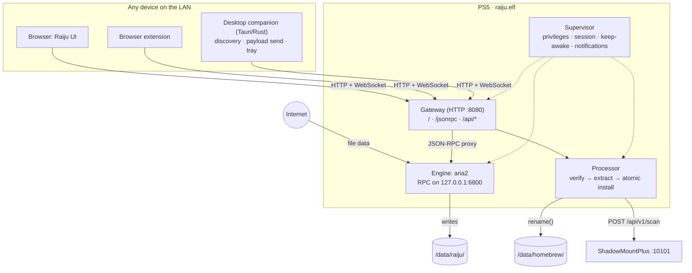

# Raiju — Architecture

## Overview



Data path for a download: **Internet → PS5 NIC → aria2 → NVMe → (extract) → rename into place**. Clients only send commands and receive progress; no file data passes through them.

## Components

### 1. Payload: `raiju.elf` (C/C++, ps5-payload-sdk)

Single ELF, sent through the existing ELF loader (port 9021).

**Supervisor**
- Gains the elevated privileges (credentials, sandbox escape) needed for full filesystem access. This follows the same pattern as `ps5-payload-dev/ftpsrv`.
- Creates `/data/raiju/{downloads,staging,session,www}` on first run.
- Starts the engine and gateway, and shows a PS5 notification: `Raiju ready — http://<ip>:8080 · code 4821`.
- Single-instance guard: if Raiju is already running, the new copy exits and re-shows the notification.

**Engine: aria2**
- Preferred: `motrixapp/aria2` (Motrix's fork: 64 connections per server, SQLite session persistence). Fallback: upstream aria2 1.37+.
- Build: static, `--without-gnutls --with-openssl --with-libz --without-libxml2 --without-sqlite3` for M0; add c-ares, then libxml2/sqlite later.
- Integration mode (decide in M0, record as ADR):
  - **A. Embedded `libaria2`** (`--enable-libaria2`) running in a thread inside `raiju.elf`, with `enable-rpc=true` set in its options. One process, one ELF.
  - **B. Standalone `aria2c`** started by the supervisor. Simpler build, but needs process spawning to work from a payload.
- aria2 runs a single event loop on FreeBSD `kqueue`. TLS on a Zen 2 core with AES-NI handles well over 1 Gbps, so one thread is not the bottleneck.

**Processor (post-download pipeline)**

Runs in its own worker thread. When aria2 reports a download complete (`onDownloadComplete`), the processor picks up that job. Each job is a small state machine, persisted to `/data/raiju/session/jobs.json`. On startup it resumes from the last completed stage.

```mermaid
stateDiagram-v2
    direction LR
    [*] --> Downloading
    Downloading --> Verifying
    Verifying --> Classifying
    Classifying --> Installing: image
    Classifying --> Extracting: archive
    Classifying --> Installing: other
    Extracting --> Installing
    Installing --> Rescan
    Rescan --> Notifying
    Notifying --> Ready
    Ready --> [*]
    Downloading --> Failed
    Verifying --> Failed
    Extracting --> Failed
    Installing --> Failed
    Rescan --> Failed
    Failed --> Downloading: retry
    note right of Failed: keeps files; retry or discard
```



1. **Verify.** Final size equals `Content-Length`. No checksum is expected; integrity comes from archive CRCs during extraction (step 3), the image's structural checks (step 2b), and the confirmed mount (step 6).
2. **Classify.** Look at the file's first bytes (magic), not just the extension:

   | Kind | Detection |
   |---|---|
   | 7z | `37 7A BC AF 27 1C` |
   | zip | `50 4B 03 04` |
   | rar | `52 61 72 21 1A 07` |
   | zstd / xz / gzip (tar.*) | `28 B5 2F FD` / `FD 37 7A 58 5A 00` / `1F 8B` |
   | `.exfat` image | `EXFAT   ` at offset 3 |
   | `.ffpkg` (UFS2) image | UFS2 superblock magic `0x19540119` at offset 65536 + 1372 |
   | `.ffpfs` / `.ffpfsc` | extension + PFS header check |

   An image with the wrong header, e.g. an HTML error page saved as `.ffpkg`, fails the job instead of being installed.

   **2b. Structural check (images).** exFAT: verify the boot-region checksum (sector 11 of the boot region), that the volume length fits in the file, and the 64 KiB cluster size ShadowMountPlus recommends, warning otherwise. UFS2: check the superblock's block/fragment sizes and that the image size covers the filesystem size.

   **2c. Identify the title.** Decide the install name `<TITLE_ID>`:
   1. Read `sce_sys/param.json` → top-level `titleId`, which must be four uppercase letters and five digits; a malformed document or value counts as missing. For archives, from the entry while extracting. For folder dumps, from disk. For images, read-only through a minimal exFAT/UFS2 reader that only walks root → `sce_sys` → `param.json` (exFAT is simple; UFS2 is about a day of work).
   2. Otherwise, use a regex on the original file or archive name: `(PPSA|CUSA)\d{5}`.
   3. Otherwise, pause the job and ask the user in the UI.
   `param.json`'s display name (`localizedParameters`) is stored with the job for the UI. If (1) and (2) disagree, (1) wins and the UI shows a note.
3. **Extract** (archives only). libarchive reads the archive in order and writes into `/data/raiju/staging/<job-id>/`.
   - Every entry path is normalized and rejected if absolute or containing `..`. Symlinks and hardlinks inside archives are refused.
   - Large write buffers (1 MiB) and no per-file fsync during extraction; one `fsync` pass over the result happens before install.
   - Layout normalization: a folder dump must have `sce_sys/` at its root. If the archive wraps it in extra folders (`Game/Game/sce_sys`), Raiju strips them. If the archive contains a single SMP image, that image becomes the install payload.
   - Progress is reported as bytes extracted out of the total, read from the archive index.
   - Pause and cancel are honoured between entries. Resuming restarts the archive from the beginning, because libarchive can't resume mid-stream; the staging folder is wiped first.
4. **Install.** `rename()` from staging (or from downloads, for images) to the destination. It's atomic because `/data/raiju` and `/data/homebrew` are on the same filesystem.
   - Destination defaults: images go to `/data/homebrew/<TITLE_ID>.<ext>` (extension in lowercase, e.g. `PPSA24003.exfat`), folder dumps to `/data/homebrew/<TITLE_ID>/`. The root is configurable, e.g. `/data/etaHEN/games`.
   - If the name already exists, the job waits for the user to choose rename, replace or cancel. "Replace" renames the old copy to a trash folder first, then deletes it after the swap.
5. **Rescan and confirm.** `POST http://127.0.0.1:10101/api/v1/scan` with `{}`, then poll `/api/v1/images` / `/api/v1/games` until the new image is mounted and reports the expected title ID. This is the final integrity check. A mount failure is surfaced in the UI with ShadowMountPlus's error. Skipped silently if ShadowMountPlus isn't running. Its API listens on loopback by default, so no SMP configuration is needed.
6. **Clean up.** Delete the archive (the default, toggleable) and the staging folder.

Space accounting. Before download: `archive_size + uncompressed_size + 1 GiB margin ≤ free(/data)`. For 7z/zip the uncompressed size comes from the file index at the end of the archive, read with an HTTP range request. For tar.* it's unknown up front, so Raiju warns and estimates 1× the archive size.

Libraries: libarchive (BSD), built with zstd, xz/lzma, zlib and bzip2. If benchmarks show 7z LZMA2 is the bottleneck, add 7-Zip's C decoder (`LzmaDec`/`Lzma2DecMt`, public domain), which can decode LZMA2 on multiple threads when the archive was created with multiple blocks.

**Gateway (HTTP server)**
- Small embeddable server, e.g. CivetWeb (MIT). Avoid Mongoose: its open-source license is GPLv2-only, which is incompatible with GPLv3.
- Serves the UI, which is embedded in the ELF at build time. If `/data/raiju/www` exists it takes precedence, which lets you update the UI without rebuilding the ELF.
- Reverse-proxies `/jsonrpc` (HTTP and WebSocket) to aria2 on loopback and injects the aria2 secret. Clients never see that secret.
- Auth: on first visit the UI asks for the 4-digit pairing code shown on the PS5. The gateway then issues a long-lived device token, stored in an HTTP-only cookie (extension clients send it as a header). Tokens can be revoked in Settings.

**Raiju system API (`/api`)**

| Endpoint | Purpose |
|---|---|
| `GET /api/status` | Version, uptime, firmware, IP, engine health |
| `GET /api/storage` | Total and free bytes of `/data` (via `statfs`) |
| `GET /api/folders` | Browse download destinations under `/data` (allowlisted roots) |
| `GET /api/jobs`, `GET /api/jobs/:id` | Pipeline state per download (stage, progress, error) |
| `POST /api/jobs` | Add a download with pipeline options: destination root, title ID override, keep archive, conflict policy. Wraps `aria2.addUri`. |
| `POST /api/jobs/:id/{retry,cancel,resolve}` | Retry a failed stage, cancel, or answer a name-conflict prompt |
| `POST /api/probe` | Before downloading: HEAD + range-read a URL to get size, kind, uncompressed size and a fits/doesn't-fit verdict |
| `POST /api/power/keep-awake` | Toggle "keep awake while downloading" |
| `POST /api/pair`, `DELETE /api/devices/:id` | Pairing and device token management |

### 2. Web UI (`ui/`)

- **Stack:** Vite + React + TypeScript + Tailwind CSS v4 + shadcn/ui. It's a static SPA, with no SSR and no Next.js, because the PS5 serves it as plain files.
- **Data layer:**
  - A typed aria2 JSON-RPC client with a WebSocket connection: `aria2.onDownloadStart/Pause/Complete/Error` events trigger refetches.
  - Polling `tellActive` once per second while the window is visible. `tellWaiting`/`tellStopped` are fetched on demand.
  - TanStack Query for caching and refetching.
- **Budget:** ≤ 300 KB gzipped total, since it's embedded in the ELF.
- Design system and screens: see [DESIGN.md](DESIGN.md).

### 3. Desktop companion (`companion/`, M2)

- **Tauri 2:** a Rust backend with the same `ui/` web app as its front end, so the UI stays identical on every platform. It builds for macOS, Windows and Linux with small native binaries (no bundled Chromium).
- **The Rust backend does what a browser can't:**
  - **Discovery:** scan the local subnet for the Raiju gateway (`GET /api/status` on port 8080). Later: mDNS, if the PS5 side supports it.
  - **Payload send:** push `raiju.elf` (bundled with the app) to the ELF loader on TCP 9021. Detect "PS5 reachable but Raiju not running" and offer to send it.
  - **Tray and notifications:** menu-bar/tray speed readout, and native notifications on job completion.
  - **Wake (M3):** the Remote Play wake packet.
- **The companion never touches file data**, so it doesn't affect transfer speed. Rust is there for a small, fast, cross-platform shell.

### 4. Browser extension (`extension/`, M2)

A Manifest V3 extension that intercepts downloads and sends them to `http://<ps5>:8080/jsonrpc` with the device token. Until M2, the existing "Aria2 Integration" extension works pointed at the gateway.

## Speed: how Raiju matches Motrix

Motrix's speed is aria2 with good defaults. Raiju ships the same tuning, editable in Settings:

| Option | Raiju default | Why |
|---|---|---|
| `max-connection-per-server` | 16 (64 with the motrix fork) | Parallel TCP streams beat per-connection throttling |
| `split` | 16 (64 with the fork) | Pieces in flight per task |
| `min-split-size` | 10M | Don't split small files into tiny ranges |
| `max-concurrent-downloads` | 5 | |
| `disk-cache` | 64M | Batches writes; fewer NVMe syncs |
| `file-allocation` | `falloc` if the PS5 filesystem supports `posix_fallocate`, else `none` | Avoid writing zeros twice; measure in M0 |
| `no-file-allocation-limit` | 64M | |
| `enable-http-keep-alive` | true | |
| `async-dns` + c-ares | on (M1) | Faster connection setup |
| `optimize-concurrent-downloads` | off (test) | |
| `socket-recv-buffer-size` | tune in M0 | Large TCP windows for high-latency servers |

Physical ceiling is the PS5's 1 GbE port (~110–117 MB/s). Wi-Fi rarely gets close to it.

### End-to-end time: the format matters more than the code

Total time in v1 = download + extraction (if any). Approximate figures for a 100 GB dump on wired gigabit:

| Hosted as | Download | Extraction | Total |
|---|---|---|---|
| `.ffpkg` / `.exfat` | ~15 min | none | **~15 min** |
| `.ffpfsc` | less than 15 min (compressed) | none; decompressed at play time | **< 15 min** |
| `.tar.zst` | ~14 min | ~2 min (zstd decodes at 1+ GB/s per core) | ~16 min |
| `.7z` LZMA2 | ~14 min | ~12–30 min (roughly 50–150 MB/s) | ~30–45 min |

Game assets are mostly already compressed, so LZMA usually saves only 5–15% of download size while costing the most time.

### Streaming extraction (M3)

aria2 writes pieces out of order, so v1 extracts only after the download completes. The theoretical maximum is a custom engine that:
- downloads parallel byte ranges into a reorder buffer;
- feeds the decompressor in order as the data arrives;
- writes straight into staging.

Total time then becomes max(download, extraction) instead of their sum, and the archive never occupies disk space. This only works for sequential formats (`tar.zst`, `tar.xz`); 7z and zip need random access to their index. Resume needs checkpoints at independent zstd frames, i.e. the seekable zstd format. Build it only if M1 benchmarks show extraction dominates.

## Language choices

| Part | Language | Why |
|---|---|---|
| `raiju.elf` (engine, processor, gateway) | C/C++ | aria2 and libarchive are C/C++ and already heavily optimized. The ps5-payload-sdk is a clang/C toolchain. No language change makes the network or LZMA faster. |
| Streaming engine (M3) | C, or Rust if a spike proves it builds | Rust can target the PS5 in principle (x86_64 FreeBSD target linked against the SDK's libc), but there's no established toolchain. Spike before committing. |
| Web UI | TypeScript (React, shadcn) | Shared by browser, companion and extension |
| Desktop companion | Rust (Tauri) | Small, fast, cross-platform; native networking for discovery and payload send |

## Persistence

- `save-session=/data/raiju/session/aria2.session`, `save-session-interval=10`, `input-file` = the same file on start, and `force-save=true` so paused and completed tasks survive too.
- With the motrix fork's SQLite persistence, progress is saved to a database instead. That's an optional upgrade.
- The supervisor also forces a session save on shutdown signals and before rest mode, if a suspend notification is available.

## Power states

| State | Raiju behaviour |
|---|---|
| On, screen on or off | Full speed |
| Idle timer about to trigger rest mode | **Keep-awake:** while any task is active, the supervisor periodically resets the idle timer (PS4 had `sceSystemServicePowerTick`; the PS5 equivalent needs confirming in M1). Once the queue is empty, the console sleeps normally. |
| Rest mode | Userland is suspended, so **no downloading**. On resume: if the payload survived, aria2 retries its connections and continues. If not, re-send the ELF and the session restores. |
| Off / reboot | Payload is gone. Re-send the ELF and the session restores. |
| Wake from network (research) | The Remote Play wake packet (UDP 9302 on PS5) plus a registration credential can wake the console. The payload must still be re-sent or auto-loaded afterwards. |

Downloading during rest mode itself isn't possible from a payload.

## Security

- aria2 RPC binds to loopback only; the gateway is the only network entry point.
- Pairing code plus device tokens; no anonymous access.
- File paths from clients are resolved and checked against allowlisted roots (`/data/raiju`, `/data/pkg`, `/data/homebrew`, `/data/etaHEN/games`). This blocks `../` and symlink escapes.
- Archive entries go through the same checks: no absolute paths, no `..`, no symlinks or hardlinks, so a malicious archive can't write outside staging.
- LAN only; no port forwarding or UPnP for the gateway port.

## Repository layout

```
raiju/
├─ payload/          # raiju.elf: supervisor, gateway, processor, API
│  ├─ src/
│  ├─ processor/     # portable C11 pipeline stages; `make -C payload/processor test` runs host unit tests
│  ├─ third_party/   # aria2 (fork), libarchive, openssl, zlib, zstd, xz, c-ares, civetweb
│  └─ Makefile
├─ ui/               # Vite + React + shadcn SPA (shared by all clients)
├─ companion/        # Tauri 2 desktop app (Rust), wraps ui/ (M2)
├─ extension/        # MV3 browser extension (M2)
├─ docker/           # reproducible toolchain image for ps5-payload-sdk
├─ docs/adr/         # architecture decision records
├─ PRODUCT.md  ARCHITECTURE.md  DESIGN.md
```

Build: `make ui` (outputs `ui/dist`) → `make payload` (embeds `ui/dist` and outputs `raiju.elf`) → `make send PS5_HOST=…` (pushes to port 9021).

## Licensing

Raiju is **GPL-3.0-or-later**, matching ps5-payload-dev projects such as ftpsrv and elfldr. Its dependencies are compatible with that:
- aria2 is GPLv2-or-later, so it can be combined into a GPLv3 work. Avoid any dependency that is GPLv2-*only*.
- OpenSSL 3 is Apache-2.0, which is compatible with GPLv3 (unlike with GPLv2).
- libarchive, zstd and xz are BSD/0BSD-style; CivetWeb is MIT.
- Motrix is MIT: its configuration choices and UI patterns can be referenced freely.
- ShadowMountPlus is GPLv3. Raiju calls its HTTP API today, and could also reuse its code if ever needed, e.g. its image readers.

## Risks and M0 spikes

1. **C++ runtime and threading in the payload SDK** for aria2. Spike: get `aria2c --version` to run on the console.
2. **OpenSSL build for the PS5 target**, plus a CA bundle shipped at `/data/raiju/ca.pem`.
3. **Embedded libaria2 vs standalone** (integration mode A vs B).
4. **`posix_fallocate` support on `/data`**, and sustained write speed.
5. **Keep-awake API**, and whether the payload survives rest mode.
6. **libarchive build and throughput** on the PS5 for 7z LZMA2, zip and tar.zst, measured on a real 50 GB dump.
7. **ShadowMountPlus behavior with renamed-in images:** confirm a `rename()` into a scan path plus `/api/v1/scan` mounts immediately. Also check how `scan_depth` treats images placed directly in `/data/homebrew` vs in a subfolder.
