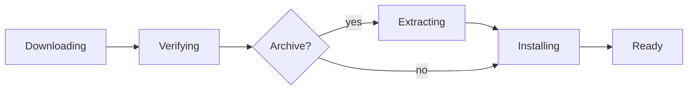

# Raiju — Product

> Download anything on any device, land it directly on your PS5's internal NVMe.

## Problem

Getting large game dumps onto a jailbroken PS5 today means:

1. downloading them to a laptop,
2. decompressing them there (which needs disk space for both the archive and the extracted files),
3. copying the result to the PS5 over Wi-Fi or FTP.

For dumps of 50–150 GB that takes hours. The laptop has to stay awake throughout, and FTP tools have no queue, no resume and no parallel connections. The dumps are hosted online by the user, in mixed formats: some are archives (`.7z`, `.zip`, `.tar.*`), others are ready-to-mount ShadowMountPlus images (`.ffpkg`, `.exfat`, `.ffpfs`, `.ffpfsc`).

## Solution

Raiju is a payload (`raiju.elf`) that turns the PS5 into its own download manager:

- The **download engine runs on the PS5** (aria2), so files go Internet → PS5 → NVMe in a single hop.
- A **web UI served by the PS5** lets you control it from any browser on your network — laptop, phone, tablet — with nothing to install.
- A **browser extension** hands off downloads you click straight to the PS5.
- A **post-download pipeline on the PS5** verifies each finished file, extracts it if it's an archive, and moves it into place atomically. Ready-to-mount images skip extraction entirely. Partial or corrupt data never reaches `/data/homebrew`.
- An optional **desktop companion** (Tauri, Rust) for macOS, Windows and Linux finds the PS5 on the LAN and sends the payload in one click.

## Target user

A PS5 owner who already has a jailbreak and an ELF loader running, is comfortable sending payloads, and wants Motrix-class downloading without the computer in the middle.

## Goals

1. **Max throughput.** Saturate whatever is slower: the internet line or the PS5's 1 GbE port (~110 MB/s).
2. **Never lose progress.** Pause, resume, crash, payload restart, console reboot — a download always continues from where it was.
3. **Companion feel.** The UI should feel like a first-party PS5 companion: monochrome, calm, focused. See [DESIGN.md](DESIGN.md).
4. **Zero install on clients.** Open a URL; that's it.

## Non-goals (for now)

- Running on non-jailbroken consoles.
- Installing `.pkg`s automatically (possible later — see roadmap).
- Remote access from outside the LAN.
- Replacing Motrix on the desktop for downloads that should stay on the computer.

## Feature scope

Speed in Motrix comes from aria2 tuned well (and, in Motrix v2, a patched aria2 — `motrixapp/aria2` — that allows up to 64 connections per server instead of 16). Raiju uses the same engine, so the same speed is reachable. Parity plan:

| Feature | Motrix | Raiju v1 | Later |
|---|---|---|---|
| HTTP/HTTPS/FTP, multi-connection split downloads | ✅ | ✅ | |
| Up to 64 connections per server (patched aria2) | ✅ | ✅ if `motrixapp/aria2` ports cleanly, else 16 | |
| Pause / resume / remove, per-task and all | ✅ | ✅ | |
| Queue with max concurrent downloads | ✅ | ✅ | |
| Resume after restart (session persistence) | ✅ | ✅ | |
| Global & per-task speed limits | ✅ | ✅ | Speed profiles |
| BitTorrent + magnet, per-file selection | ✅ | ✅ | |
| Tracker list auto-update | ✅ | | ✅ |
| UPnP / NAT-PMP port mapping | ✅ | | ✅ |
| Notifications on completion | ✅ system | ✅ PS5 notification + browser | |
| Browser extension | ✅ | Use existing "Aria2 Integration" extension | Own extension |
| Dashboard / transfer stats | ✅ | ✅ live speed graph | History |
| Plugins, URL resolvers | ✅ | | Maybe |
| PS5 storage free space, pre-flight "won't fit" check | — | ✅ | |
| Folder presets for PS5 paths | — | ✅ | |
| Keep console awake while downloading | — | ✅ (if API confirmed) | |
| Auto-install finished `.pkg` | — | | ✅ |
| Verify → extract → atomic install pipeline | — | ✅ | |
| ShadowMountPlus image detection + rescan | — | ✅ | |
| Title-ID naming (`PPSA24003.exfat`) from `param.json` or file name | — | ✅ | |
| Integrity checks without checksums (size, archive CRCs, image structure, confirmed mount) | — | ✅ | |
| Archive formats: 7z, zip, tar.{zst,xz,gz}, rar | — | ✅ (libarchive) | Faster 7z decoder |
| Streaming extraction while downloading | — | | ✅ (v2, `tar.zst` only) |
| Desktop companion (macOS/Windows/Linux) | ✅ (Electron) | | ✅ (Tauri) |

## Large dumps workflow

Every download goes through the same staged job. The UI shows each stage:

| What you download | What Raiju does | Ends up in |
|---|---|---|
| ShadowMountPlus image: `.ffpkg`, `.exfat`, `.ffpfs`, `.ffpfsc` | Checks the image header, then moves the file into place. **No extraction.** | `/data/homebrew/<TITLE_ID>.<ext>` |
| Archive containing an image, e.g. `PPSA24003-some-game-name.7z` | Extracts the image, checks its header, moves it into place | `/data/homebrew/<TITLE_ID>.<ext>`, e.g. `PPSA24003.exfat` |
| Archive containing a folder dump (has `sce_sys/`) | Extracts it, removes extra top-level folders so `sce_sys/` is at the game folder's root, moves it into place | `/data/homebrew/<TITLE_ID>/` |
| Anything else (`.pkg`, media, homebrew `.elf`) | Moves it to the folder you picked | The chosen folder |

### Naming and placement

Dumps arrive with arbitrary names (e.g. a friend's `PPSA24003-some-game-name.7z`). Raiju always installs them under the game's title ID:

- **Images** go directly in `/data/homebrew/` as `<TITLE_ID>.<ext>`, with the extension in lowercase, e.g. `PPSA24003.exfat`.
- **Folder dumps** go in `/data/homebrew/<TITLE_ID>/`.
- This layout works with ShadowMountPlus's default `scan_depth=1`, which finds image files at the scan root and game folders one level down, but not images inside subfolders. No ShadowMountPlus configuration needed.
- **The title ID comes from, in order:**
  1. `sce_sys/param.json` inside the dump;
  2. a `PPSA12345` / `CUSA12345` pattern in the file or archive name;
  3. the user, if neither works. The job pauses and asks.
- The game's display name (from `param.json`) is shown in the UI only, never used in the file name.

Rules that prevent corruption:

1. **Never write into a scanned folder while working.** Downloads go to `/data/raiju/downloads/`, extraction goes to `/data/raiju/staging/`. Both are on the same filesystem as `/data/homebrew`, so the final step is an instant, atomic `rename()`. ShadowMountPlus never sees a half-written file.
2. **Verify before installing, without needing a checksum.** Dumps often come from friends with arbitrary names and no checksum, so Raiju relies on checks it can do itself:
   - the downloaded size must match the server's `Content-Length`;
   - archives are checked during extraction by their own built-in CRCs (7z and zip store a CRC32 per file; zstd frames usually carry a checksum);
   - images get a structural check (exFAT boot-region checksum, UFS2 superblock sanity);
   - after install, ShadowMountPlus must mount the image and report the expected title ID.
3. **Check space before downloading.** Archives need space for the archive *and* the extracted files. For `.7z`/`.zip`, Raiju reads the archive's file index (stored at the end of the file) with a small HTTP range request before downloading, and refuses jobs that won't fit.
4. **Never overwrite silently.** If the target name already exists in `/data/homebrew`, Raiju asks: rename, replace, or cancel.
5. **Tell ShadowMountPlus.** After installing, Raiju asks ShadowMountPlus (through its local API) to rescan, so the game appears without waiting for its next scan.

**Hosting advice for the fastest end-to-end time:**
- Prefer hosting `.ffpkg` images directly. Download done = game ready.
- If you want a smaller download, `.ffpfsc` is compressed but mounts without extraction. The cost is in-game read speed of about 150–250 MB/s, according to ShadowMountPlus.
- If you must use archives, use `tar.zst` or 7z with zstd/store. Classic 7z LZMA extracts at roughly 50–150 MB/s on one PS5 core, which can double the total time.

## Pause, resume, and recovery semantics

- **Pause** stops network activity for a task; partial data and its `.aria2` control file stay on disk.
- **Resume** continues from the last written piece, using HTTP range requests or BitTorrent piece state.
- **Payload restart / console reboot:** Raiju reloads its saved session on start; every task returns in the state it was in (active tasks resume automatically, paused ones stay paused).
- **Server doesn't support ranges:** the task is flagged "can't resume" in the UI before you pause it.

## Rest mode

A payload cannot download while the PS5 is in rest mode: rest mode suspends userland processes, including Raiju. What Raiju does instead:

1. **Keep awake while busy (primary).** While any download is active, Raiju keeps the console from entering rest mode on its own, then lets it sleep once the queue is empty. The screen can still turn off.
2. **Survive rest mode (best effort).** If the console is put into rest mode anyway, Raiju saves its session first. Whether the payload and jailbreak survive resume depends on firmware and jailbreak — to be measured. If it survives, downloads resume; otherwise re-send the ELF and the session restores.
3. **Wake from network (later, research).** The PS5 can be woken over LAN with the Remote Play wake protocol (requires a Remote Play registration credential and "Enable turning on PS5 from network"). A future "Wake & download" button could wake the console, but the payload still has to be running afterwards.

See [ARCHITECTURE.md § Power states](ARCHITECTURE.md#power-states) for the technical detail.

## Success metrics

- Single large HTTPS file from a fast CDN on wired gigabit: **≥ 100 MB/s sustained**.
- `.ffpkg` dump: playable within 30 s of the download finishing.
- Zero partially-written files ever visible in `/data/homebrew`, including when the payload is killed mid-job.
- 100 % of in-progress tasks recover after a payload restart.
- Add-to-downloading in under 5 seconds from a phone.

## Roadmap

1. **M0 — Engine:** aria2 and libarchive cross-compiled and running on the PS5. aria2 controlled via AriaNg; extraction speed benchmarked.
2. **M1 — Raiju v1:** post-download pipeline (verify, extract, atomic install, ShadowMountPlus rescan), own web UI, session persistence, PS5 notifications, storage info, keep-awake.
3. **M2 — Integrations:** desktop companion (Tauri: discovery, one-click payload send, tray), Raiju browser extension, speed profiles, tracker updates, UPnP.
4. **M3 — Max speed and extras:** streaming extraction (download and decompress at the same time), `.pkg` auto-install, wake from network.

## Open questions

- Does `motrixapp/aria2` build against the PS5 payload SDK as easily as upstream aria2?
- Which system call keeps the console awake from a payload, and does it work on all supported firmwares?
- Does the payload survive rest mode → resume on the target jailbreak?
- Real extraction throughput of libarchive on the PS5 for 7z LZMA2 vs zstd. Is a dedicated 7-Zip decoder worth it?
