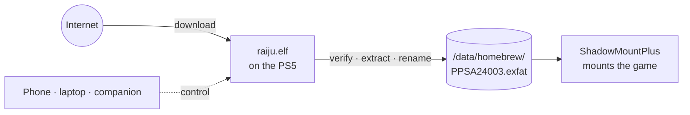
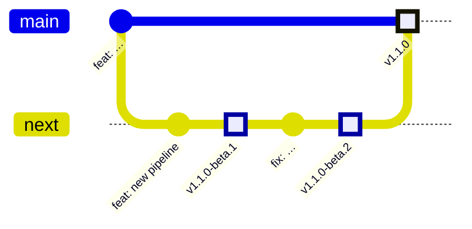

# Raiju

Download straight to your jailbroken PS5's internal NVMe: no laptop in the middle, no manual extraction, no copying over Wi-Fi.

Raiju is a PS5 payload (`raiju.elf`) that runs a download engine (aria2) on the console. It verifies and extracts dumps on the PS5, then installs them atomically where ShadowMountPlus picks them up. You control it from a web UI that the PS5 serves itself, or from a desktop companion app.



## Docs

| Doc | What's in it |
|---|---|
| [PRODUCT.md](PRODUCT.md) | Problem, features, large-dump workflow, roadmap |
| [ARCHITECTURE.md](ARCHITECTURE.md) | Components, pipeline, speed, power states, security |
| [DESIGN.md](DESIGN.md) | Monochrome companion design system and screens |

## Status

Pre-alpha: design docs only. Next milestone is **M0**: aria2 and libarchive running on the PS5.

## Development

Requirements: [Bun](https://bun.sh) ≥ 1.3. For the payload: clang 18, lld 18, and the [ps5-payload-sdk](https://github.com/ps5-payload-dev/sdk).

```sh
bun install        # installs tooling and git hooks
bun run check      # Biome lint + format check
bun run fix        # apply Biome fixes
```

### Commits

[Conventional Commits](https://www.conventionalcommits.org), enforced by commitlint in a `commit-msg` hook and in CI. Biome checks staged files in a `pre-commit` hook.

```
feat(processor): extract tar.zst archives
fix(gateway): reject archive entries containing ..
docs: describe rest-mode behaviour
```

Scopes: `payload`, `engine`, `processor`, `gateway`, `ui`, `companion`, `extension`, `docs`, `ci`, `deps`, `release`.

PRs are squash-merged, so the PR title must also be a conventional commit.

### Releases

Releases are fully automated by [semantic-release](https://semantic-release.gitbook.io) from commit messages.



| Branch | Channel | Example version | GitHub release |
|---|---|---|---|
| `main` | stable | `v1.1.0` | Latest |
| `next` | beta | `v1.1.0-beta.2` | Pre-release |

- `fix:` → patch, `feat:` → minor, `feat!:` or `BREAKING CHANGE:` → major. `docs:`, `chore:`, `ci:` etc. don't release.
- Each release ships whatever the build produced: `raiju.elf`, `raiju-ui.zip`, and later the companion installers.

## License

GPL-3.0-or-later. See [LICENSE](LICENSE).
